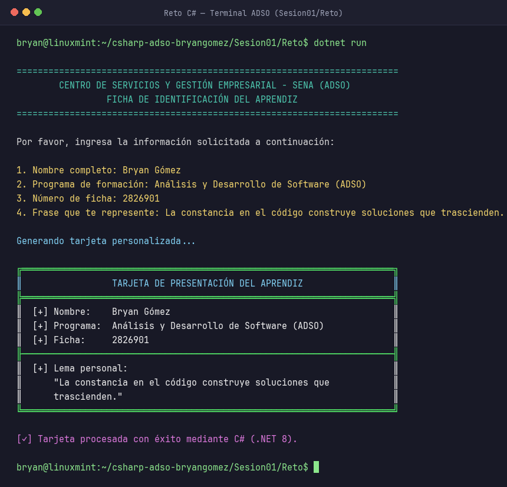

# Sesión 01 - Reto: Tarjeta de Presentación en C#

Este proyecto corresponde al reto práctico de la Sesión 01 para el programa de formación **Análisis y Desarrollo de Software (ADSO)** del SENA.

---

## Requerimientos cumplidos

1. **Captura de al menos 4 datos por consola**:
   - Nombre completo
   - Programa de formación
   - Número de ficha
   - Frase representativa
2. **Tarjeta con bordes e interpolación**:
   - Borde rectangular simétrico (`╔═╗`, `║`, `╚═╝`).
   - Interpolación de variables de cadena (`$""`).
   - Formateo y ajuste de texto automático para evitar que se rompan los bordes.
3. **Uso de múltiples colores de consola**:
   - `ConsoleColor.DarkCyan` (Encabezado general)
   - `ConsoleColor.Yellow` (Preguntas de captura de datos)
   - `ConsoleColor.Green` (Bordes y separadores de la tarjeta)
   - `ConsoleColor.Cyan` (Título de la tarjeta)
   - `ConsoleColor.White` (Información del aprendiz)
   - `ConsoleColor.Magenta` (Mensaje de finalización)
4. **Comentarios explicativos**:
   - Cada sección del código cuenta con comentarios claros y detallados.

---

## Captura de la Consola en Ejecución



---

## Cómo ejecutar el proyecto

Desde una terminal situada en esta carpeta:

```bash
dotnet run
```
