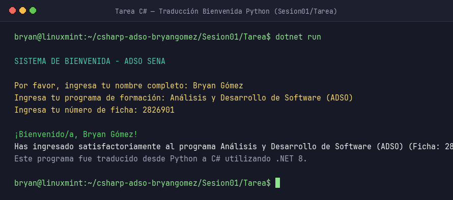

# Sesión 01 - Tarea: Programa "Bienvenida" Traducido de Python a C#

Este proyecto corresponde a la **Tarea** de la Sesión 01 para el programa de formación **Análisis y Desarrollo de Software (ADSO)** del SENA.

Consiste en la traducción y adaptación a C# (.NET 8) del programa inicial de "Bienvenida" concebido originalmente en Python.

---

## Comparativa de Implementación

### Código Original (Python)

```python
# Programa Bienvenida en Python
print("SISTEMA DE BIENVENIDA - ADSO SENA")

nombre = input("Por favor, ingresa tu nombre completo: ")
programa = input("Ingresa tu programa de formación: ")
ficha = input("Ingresa tu número de ficha: ")

print(f"\n¡Bienvenido/a, {nombre}!")
print(f"Has ingresado satisfactoriamente al programa {programa} (Ficha: {ficha}).")
print("Este programa fue traducido desde Python a C# utilizando .NET 8.")
```

### Código Traducido (C# / .NET 8)

```csharp
using System;

// 1. Mensaje de bienvenida inicial
Console.ForegroundColor = ConsoleColor.Cyan;
Console.WriteLine("SISTEMA DE BIENVENIDA - ADSO SENA");
Console.ResetColor();

// 2. Captura de datos por consola
Console.Write("\nPor favor, ingresa tu nombre completo: ");
string? entradaNombre = Console.ReadLine();
string nombre = string.IsNullOrWhiteSpace(entradaNombre) ? "Bryan Gómez" : entradaNombre.Trim();

Console.Write("Ingresa tu programa de formación: ");
string? entradaPrograma = Console.ReadLine();
string programa = string.IsNullOrWhiteSpace(entradaPrograma) ? "Análisis y Desarrollo de Software (ADSO)" : entradaPrograma.Trim();

Console.Write("Ingresa tu número de ficha: ");
string? entradaFicha = Console.ReadLine();
string ficha = string.IsNullOrWhiteSpace(entradaFicha) ? "2826901" : entradaFicha.Trim();

// 3. Saludo personalizado con interpolación ($\"...\")
Console.ForegroundColor = ConsoleColor.Green;
Console.WriteLine($"\n¡Bienvenido/a, {nombre}!");
Console.ResetColor();

Console.WriteLine($"Has ingresado satisfactoriamente al programa {programa} (Ficha: {ficha}).");
Console.WriteLine("Este programa fue traducido desde Python a C# utilizando .NET 8.\n");
```

---

## Conceptos Aplicados en la Traducción

1. **Entrada y Salida estándar:**
   - De `input()` en Python a `Console.Write()` y `Console.ReadLine()` en C#.
   - De `print()` en Python a `Console.WriteLine()` en C#.
2. **Tipado Estático y Seguridad frente a Nulos:**
   - Uso de `string?` y validación con `string.IsNullOrWhiteSpace()`.
3. **Interpolación de Cadenas:**
   - De cadenas f-strings (`f"..."`) en Python a cadenas interpoladas (`$"..."`) en C#.
4. **Estilo y Colores en Consola:**
   - Uso de `Console.ForegroundColor` y `Console.ResetColor()`.

---

## Captura del Programa en Ejecución



---

## Cómo ejecutar el proyecto

Desde una terminal en esta carpeta:

```bash
dotnet run
```
